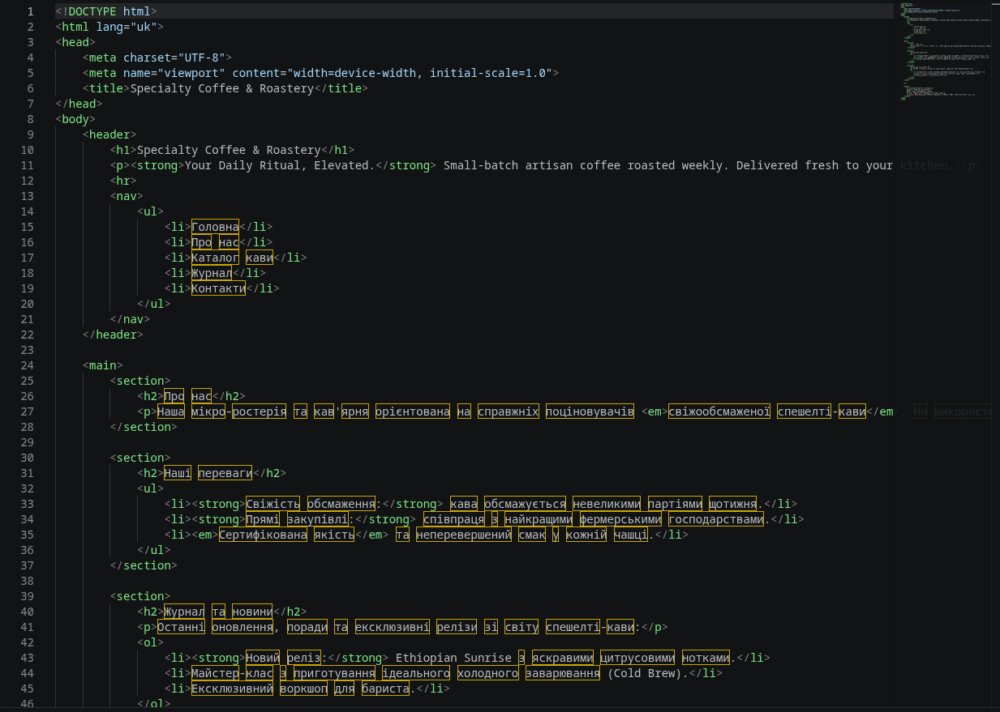
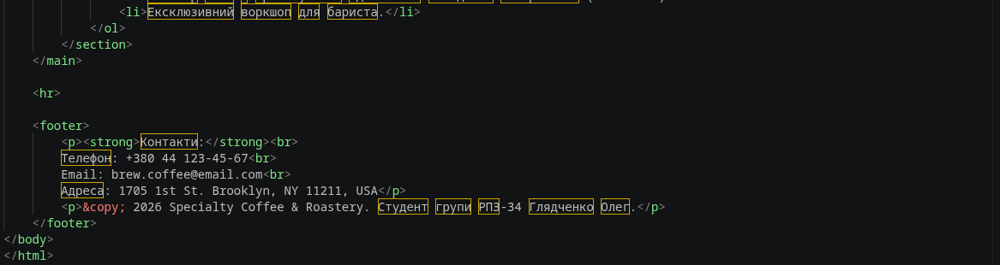
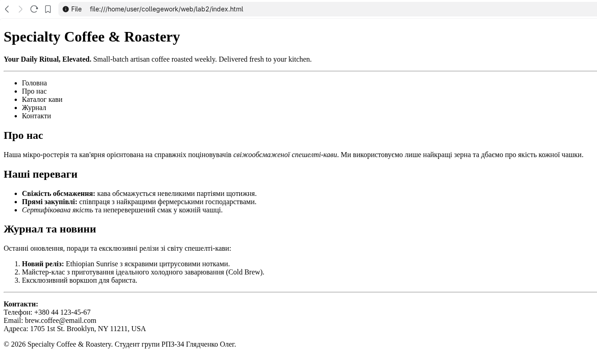

## Лабораторна робота №2

* **Тема:** Створення текстової HTML-сторінки. Структура HTML-документа.
* **Студент:** Глядченко Олег
* **Група:** РПЗ-34

---

## 1. Мета роботи

Налаштувати робоче середовище (IDE VS Code), вивчити базову структуру HTML-документа, опанувати теги заголовків, параграфів, списків та форматування тексту. Почати верстку головної сторінки (`index.html`) свого проєкту на основі прототипу з ЛР №1.

---

## 2. Хід роботи

### Крок 1. Підготовка робочого місця
1. Встановлено та налаштовано редактор коду Visual Studio Code.
2. Створено робочу папку проєкту.
3. У папочці створено файл головної сторінки `index.html`.

### Крок 2. Створення базової структури HTML5
За допомогою Emmet згенеровано базову структуру HTML5-документа та налаштовано атрибути:
* `lang="uk"` для вказування мови контенту;
* метатег `charset="UTF-8"` для коректного відображення кирилиці;
* метатег `viewport` для адаптивності на мобільних пристроях;
* тег `<title>` з назвою проєкту **Specialty Coffee & Roastery**.

### Крок 3. Семантична розмітка та наповнення контентом
Відповідно до прототипу з ЛР №1, за допомогою семантичних тегів побудовано та наповнено такі блоки:
* `<header>`: містить головний заголовок першого рівня `<h1>`, підзаголовок та меню навігації на основі маркованого списку `<ul>`.
* `<main>`: містить основні секції сайту (`<section>`):
  * **Про нас:** заголовок `<h2>`, описовий текст із застосуванням тегу `<em>` для акцентування.
  * **Наші переваги:** заголовок `<h2>`, маркований список `<ul>` із виділенням ключових слів тегом `<strong>`.
  * **Журнал та новини:** заголовок `<h2>`, нумерований список `<ol>` для висвітлення останніх подій та статей.
* `<footer>`: містить контактні дані (з примусовим переносом рядка ` `), а також авторські права.

---

## 3. Вихідний код (index.html)

---

## 4. Скріншоти виконання роботи

### 4.1. Скріншоти коду в VS Code

### 4.2. Скріншот сторінки в браузері

---

## 5. Відповіді на контрольні запитання

### 1. Для чого потрібен тег `<!DOCTYPE html>`?
Він повідомляє браузеру, що документ написаний за стандартом HTML5. Це гарантує правильне відображення сторінки в стандартному режимі (Standards Mode) без перемикання в режим сумісності застарілих версій.

### 2. У чому різниця між тегами `<ul>` та `<ol>`?
* `<ul>` (*Unordered List*) створює маркований список, де елементи позначені маркерами (крапками).
* `<ol>` (*Ordered List*) створює нумерований список, де елементи автоматично пронумеровані цифрами або літерами.

### 3. Чому не можна використовувати тег `<h1>` п'ять разів на одній сторінці?
Тег `<h1>` означає головну тему та заголовок усієї сторінки. Для правильної семантики та SEO-оптимізації його слід використовувати лише один раз. Для розділів та підрозділів використовуються заголовки нижчих рівнів (`<h2>`–`<h6>`).

### 4. Які теги називаються парними, а які — одинарними?
* **Парні теги:** мають відкриваючу та закриваючу частини і огортають контент (наприклад, `
текст
`, `<h1>заголовок</h1>`).
* **Одинарні теги:** не потребують закриваючого тегу, оскільки не містять вкладеного тексту чи інших елементів (наприклад, ` `, `
`, `<meta>`, ``).

### 5. Де на сторінці відображається текст, написаний у тегу `<title>`?
Текст у тегу `<title>` відображається у вкладці браузера, а також слугує заголовком сайту в пошуковій видачі (наприклад, у Google).

---

## 6. Висновки

Під час виконання лабораторної роботи було опановано базову структуру HTML5-документа, налаштовано робоче середовище Visual Studio Code та розроблено текстову версію головної сторінки `index.html` для проєкту **Specialty Coffee & Roastery**. Були застосовані теги семантичної розмітки (`<header>`, `<main>`, `<footer>`, `<section>`), заголовки різних рівнів, марковані та нумеровані списки, а також базові теги форматування тексту (`<strong>`, `<em>`, ` `, `
`).
