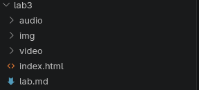
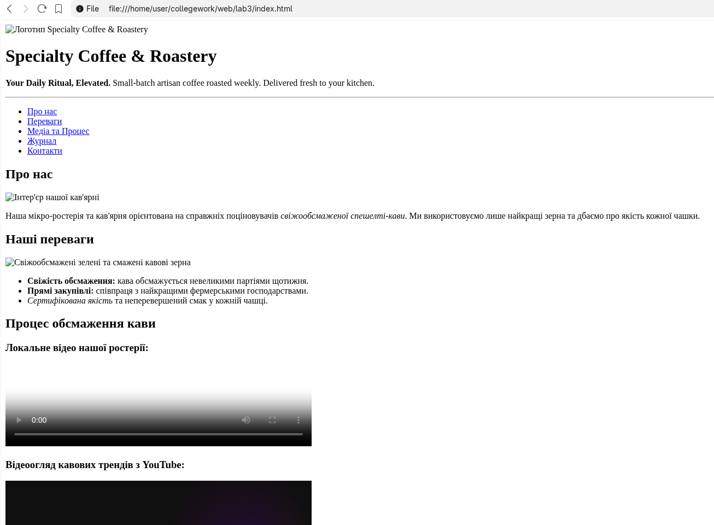
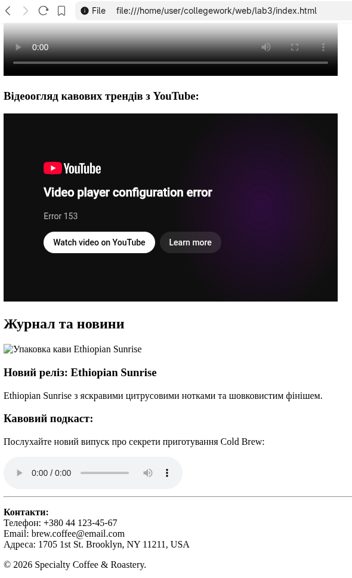

## Лабораторна робота №3
**Виконав студент групи РПЗ-34 Глядченко Олег**

* **Тема:** Використання рисунків, відео та звуку в HTML-документах.

## 1. Мета роботи

Навчитися організовувати файлову структуру проєкту, опанувати роботу з відносними шляхами до медіафайлів, навчитися інтегрувати растрові зображення, відео- та аудіоконтент на вебсторінку.

## 2. Хід роботи

### Крок 1. Організація файлової структури

1. У корінній папці проєкту створено додаткові директорії для медіаконтенту:
   * `img/` — для зберігання графічних зображень.
   * `video/` — для зберігання локальних відеофайлів.
   * `audio/` — для зберігання аудіофайлів.
2. Усі файли названо латинськими літерами у нижньому регістрі без пробілів.

### Крок 2. Додавання зображень (``)

1. **Логотип:** У шапку сайту (`<header>`) перед головним заголовком `<h1>` додано логотип бренду за допомогою відносного шляху `img/logo.png`.
2. **Контентні зображення:** У секціях `<main>` додано тематичні фотографії:
   * Описове фото ростерії в секції «Про нас».
   * Фото збірки та обсмаження кави в секції «Наші переваги».
   * Зображення упаковки моносорту `Ethiopian Sunrise` у блоці новин.
3. Для всіх зображень обов'язково вказано інформативні атрибути `alt` для забезпечення доступності (accessibility) та відображення тексту в разі збою завантаження.

### Крок 3. Інтеграція відеоконтенту

Для демонстрації процесів обсмаження кави застосовано обидва варіанти додавання відео:
* **Локальне відео (`<video>`):** Додано у секцію «Про процес обсмаження» з атрибутом `controls` (панель керування) та заставкою `poster="img/video-cover.jpg"`.
* **Вбудоване відео з YouTube (`<iframe>`):** Інтегровано тематичний ролик про спешелті-каву для оптимізації навантаження на сервер.

### Крок 4. Додавання аудіоконтенту (`<audio>`)

У секцію блогу/журналу додано аудіопрогравач для відтворення випуску кавового подкасту за допомогою тегу `<audio controls>` та вкладеного тегу `<source src="audio/coffee-podcast.mp3" type="audio/mpeg">`.

## 3. Обґрунтування вибору методу додавання відео

У проєкті використано комбінований підхід:
1. **Для коротеої фірмової презентації та промо-матеріалів бренду** обрано локальний тег `<video>`. Це дозволяє повністю контролювати зовнішній вигляд відеоплеєра, кастомну заставку (`poster`), а також автономність (відео доступне без сторонніх сервісів).
2. **Для довготривалих навчальних відео та оглядів** обрано вбудовування через `<iframe>` з YouTube. Це зменшує навантаження на хостинг, заощаджує мережевий трафік та гарантує адаптивне стримінгове відтворення під будь-яку швидкість інтернету користувача.

## 4. Скріншоти виконання роботи

### 4.1. Скріншот структури папок проєкту

*(На скріншоті видно корінь проєкту `Specialty_Coffee_Site`, файл `index.html` та папки `img/`, `video/`, `audio/`)*

### 4.2. Скріншоти сторінки в браузері (логотип, зображення, відео- та аудіоплеєр)

## 5. Відповіді на контрольні запитання

### 1. Що таке атрибут `alt` і чому його обов'язково треба заповнювати?

Атрибут `alt` (*alternative text*) містить текстовий опис зображення. Його обов'язково заповнюють з трьох причин:
* **Доступність (Accessibility):** екранні диктори (screen readers) зчитують цей текст для людей з порушеннями зору.
* **Відмовостійкість:** текст відображається замість зображення, якщо файл не завантажився (наприклад, через повільний інтернет або помилку в шляху).
* **SEO-оптимізація:** пошукові роботи (Google) використовують `alt` для індексації та розуміння вмісту малюнків.

### 2. У чому різниця між тегами `<video>` та `<iframe>`?

* **`<video>`** — це власне HTML5-тег для програвання відеофайлів, які зберігаються безпосередньо на вашому веб-сервері (наприклад, `.mp4`, `.webm`).
* **`<iframe>`** — це фрейм (вікно), який вбудовує сторонню веб-сторінку або зовнішній віджет (наприклад, відеоплеєр з YouTube/Vimeo, карту з Google Maps).

### 3. Які формати зображень найкраще підходять для вебу (фотографії vs іконки)?

* **Для фотографій та складних рисунків з багатьма кольорами:**
  * **JPEG / JPG** — хороший баланс якості та стиснення.
  * **WebP / AVIF** — сучасні високоефективні веб-формати, що забезпечують мінімальний розмір файлу.
* **Для логотипів, іконок та векторної графіки:**
  * **SVG** — векторний формат без втрати якості при масштабуванні.
  * **PNG** — растровий формат із підтримкою прозорого фону (Alpha channel).

### 4. Що станеться, якщо ви перемістите файл картинки в іншу папку, але не зміните код HTML?

Якщо перемістити файл зображення (наприклад, з `img/logo.png` у `img/header/logo.png`), браузер не зможе його знайти за старою відносною адресою. Замість зображення користувач побачить піктограму «битого файлу» та текст, вказаний в атрибуті `alt`.

## 6. Висновки

Під час виконання лабораторної роботи №3 було опановано роботу з файловою структурою веб-проєкту та відносними шляхами до медіафайлів. На практику було впроваджено додавання графічних зображень (``) з обов'язковою оптимізацією альтернативного тексту (`alt`), вбудовано відеоплеєри HTML5 (`<video>`) та фрейми YouTube (`<iframe>`), а також додано звуковий супровід за допомогою тегу `<audio>`.
